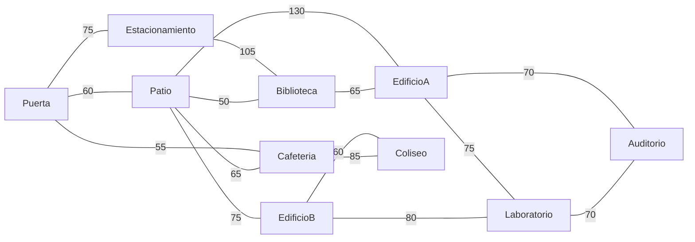

# Actividad 3 – Modelado del problema mediante grafos
 
**Responsable:** Percy Daniel Perez Rojas  
**Curso:** Algoritmo y Estructura de Datos Basados en Inteligencia Artificial  
**Evaluación:** PA4 – Grupo 7
 
## 1. Representación del problema con un grafo
 
El campus se modela como un grafo. Cada ubicación es un nodo y cada camino peatonal que une dos ubicaciones es una arista.
 
- **Nodos (10):** Puerta, Patio, Biblioteca, Edificio A, Edificio B, Cafetería, Laboratorio, Auditorio, Coliseo y Estacionamiento.
- **Aristas (15):** tramos peatonales entre ubicaciones.
- **Peso:** distancia del tramo en metros.

 
**Sentido de las conexiones:** el grafo es **no dirigido**, porque los caminos del campus se recorren en ambos sentidos. Es también **ponderado**, porque cada arista tiene una distancia. Si existiera un tramo de un solo sentido (por ejemplo, una puerta solo de salida), ese tramo sería dirigido.
 
**Representación:** se usa una **lista de adyacencia** (arreglo de `LinkedList`). El grafo es disperso, con 15 aristas para 10 nodos, así que la lista ocupa O(V + E). Una matriz de adyacencia ocuparía O(V²).
 
```text
Puerta     -> Patio(60) Cafeteria(55) Estacionamiento(75)
Patio      -> Puerta(60) Biblioteca(50) EdificioA(130) EdificioB(75) Cafeteria(65)
EdificioA  -> Patio(130) Biblioteca(65) Laboratorio(75) Auditorio(70)
Auditorio  -> EdificioA(70) Laboratorio(70)
...
```
 
## 2. Situación en la que conviene usar DFS
 
**Situación:** por mantenimiento se cierran los tramos Cafetería–Coliseo y Edificio B–Coliseo. El sistema debe verificar si todas las ubicaciones siguen siendo accesibles desde la Puerta.
 
DFS recorre en profundidad: avanza por un camino hasta el final y luego retrocede. Se implementa de forma recursiva, usando la pila de llamadas, y visita todo lo alcanzable desde un nodo en O(V + E). Si alguna ubicación queda sin visitar, está aislada. Es la aplicación de **componentes conexos** vista en clase.
 
```text
DFS con todos los tramos:
Puerta Patio Biblioteca Estacionamiento EdificioA Laboratorio EdificioB Coliseo Cafeteria Auditorio
 
DFS con los tramos cerrados:
Puerta Patio Biblioteca Estacionamiento EdificioA Laboratorio EdificioB Auditorio Cafeteria
```
 
En el segundo recorrido no aparece el **Coliseo**, así que quedó inaccesible. Aquí conviene DFS porque solo interesa saber **a qué se puede llegar**, no por qué ruta ni en qué orden.
 
## 3. Situación en la que conviene usar BFS
 
**Situación:** un visitante en la Puerta quiere llegar al Auditorio por la ruta **con menos tramos**, que es la más fácil de indicar.
 
BFS recorre por niveles usando una cola (FIFO). Primero visita los nodos a 1 tramo, luego los que están a 2, y así sucesivamente. Por eso la primera vez que llega a un nodo lo hace con el **mínimo número de aristas**: es la aplicación de **caminos mínimos en grafos no ponderados**.
 
```text
BFS Puerta -> Auditorio:
Puerta Patio EdificioA Auditorio | 3 tramos, 260 m
```
 
**Limitación:** BFS no considera los pesos, así que la ruta tiene menos tramos pero no necesariamente menos metros.
 
## 4. Aporte del algoritmo A* en una búsqueda orientada a una meta
 
**Situación:** un estudiante en la Puerta necesita llegar al Auditorio recorriendo la **menor distancia**.
 
A* elige en cada paso el nodo con menor valor de:
 
```text
f(n) = g(n) + h(n)
```
 
- **g(n):** distancia real recorrida desde el origen.
- **h(n):** heurística, es decir, lo que se estima que falta hasta la meta. Aquí se usa la distancia en línea recta al Auditorio.
La heurística es **admisible**: caminando nunca se recorre menos que la línea recta, así que h(n) no sobreestima. Por eso A* es **completo y óptimo**.
 
No se usó la distancia Manhattan, que es la del ejercicio en *grid* de la sesión, porque en este campus los tramos no siguen una cuadrícula y sobreestimaría. Por ejemplo, el tramo Puerta–Cafetería mide 55 m, pero su distancia Manhattan es 70 m. Esa heurística no sería admisible y A* dejaría de garantizar la ruta óptima.
 
```text
Expande Puerta  g=0.0  h=193.1  f=193.1
Expande Patio  g=60.0  h=138.9  f=198.9
Expande Biblioteca  g=110.0  h=121.7  f=231.7
Expande EdificioA  g=175.0  h=67.1  f=242.1
Expande Auditorio  g=245.0  h=0.0  f=245.0
 
Puerta Patio Biblioteca EdificioA Auditorio | 4 tramos, 245 m
```
 
**Qué aporta A\*:**
 
- **Orienta la búsqueda hacia la meta.** Gracias a h(n), no expandió la Cafetería, el Estacionamiento, el Edificio B, el Coliseo ni el Laboratorio, porque se alejan del Auditorio.
- **Considera los pesos.** Encontró una ruta de 245 m, más corta que la de BFS (260 m), aunque tenga un tramo más.
- **Garantiza la ruta óptima** cuando la heurística es admisible.
| Algoritmo | Estructura | Criterio | Resultado Puerta → Auditorio |
|---|---|---|---|
| DFS | Pila (recursión) | Alcanzabilidad | — |
| BFS | Cola | Menos tramos | 3 tramos, 260 m |
| A* | Cola de prioridad | Menor distancia (g + h) | 4 tramos, 245 m |
 
## Ejecución
 
```bash
javac GrafoCampus.java
java GrafoCampus
```
 