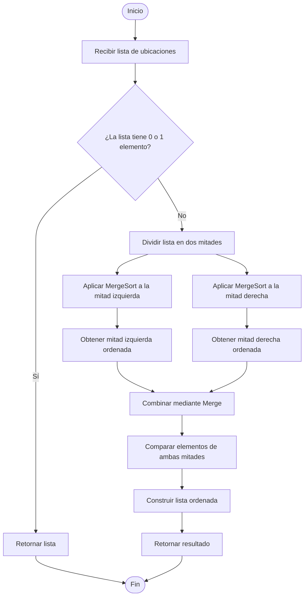

# Diagrama de flujo – Merge Sort

**Actividad:** 2 – Ordenamiento recursivo  
**Responsable:** Claudio García Pérez

## 1. Descripción

El siguiente diagrama representa el funcionamiento del algoritmo Merge Sort, utilizado para ordenar alfabéticamente las ubicaciones de un campus educativo.

El algoritmo aplica el principio divide y vencerás mediante divisiones recursivas y la combinación ordenada de los elementos.

## 2. Diagrama de flujo

## 3. Explicación del proceso

1. El algoritmo recibe una lista de ubicaciones del campus.
2. Comprueba si la lista tiene cero o un elemento.
3. Si cumple el caso base, devuelve la lista sin modificaciones.
4. Si contiene más elementos, divide la lista en dos mitades.
5. Aplica MergeSort recursivamente a cada mitad.
6. Utiliza Merge para comparar y combinar los elementos.
7. Devuelve una lista completamente ordenada alfabéticamente.

## 4. Resultado esperado

**Lista original:**

- Biblioteca
- Laboratorio
- Auditorio
- Cafetería
- Aulas
- Enfermería
- Gimnasio
- Administración

**Lista ordenada:**

- Administración
- Auditorio
- Aulas
- Biblioteca
- Cafetería
- Enfermería
- Gimnasio
- Laboratorio

## 5. Conclusión

El diagrama permite comprender visualmente cómo Merge Sort utiliza la recursividad para dividir un problema en partes pequeñas y posteriormente combinar sus resultados.

Esta técnica permite organizar eficientemente las ubicaciones del campus y facilita la consulta de información dentro del sistema de orientación.
